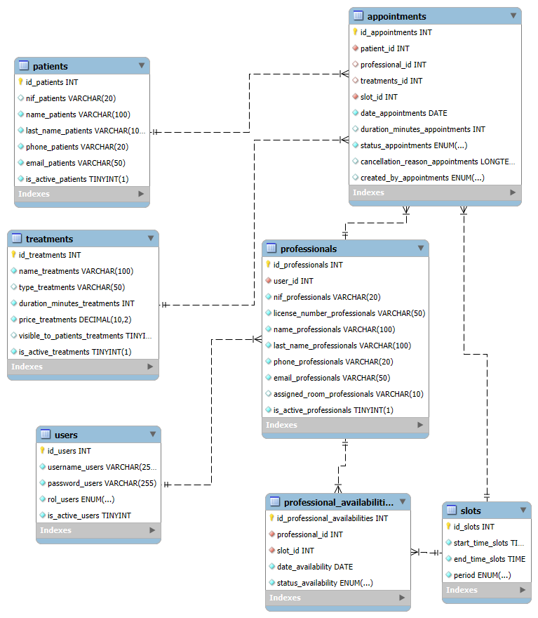
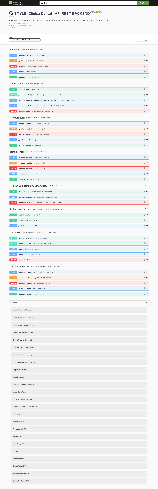
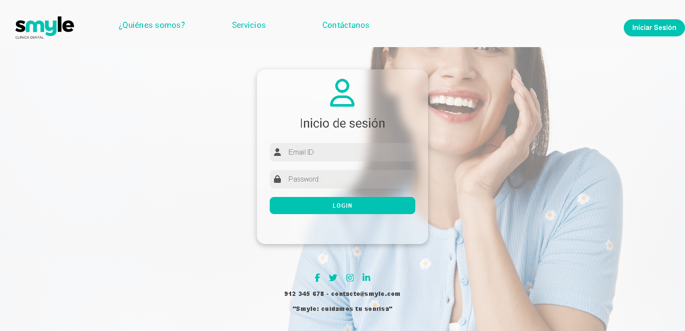
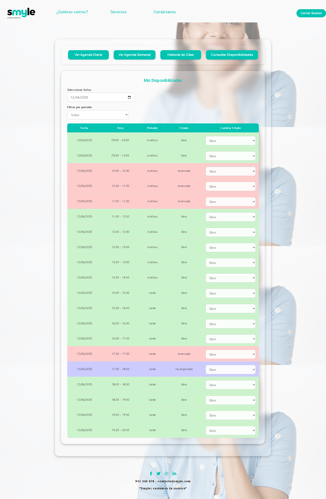
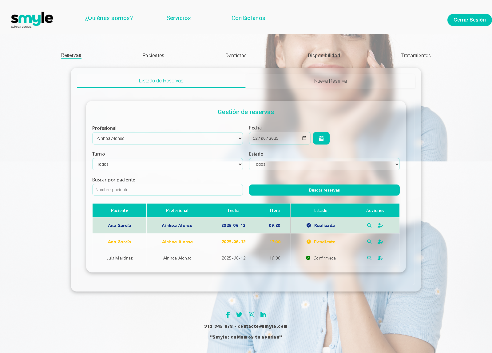
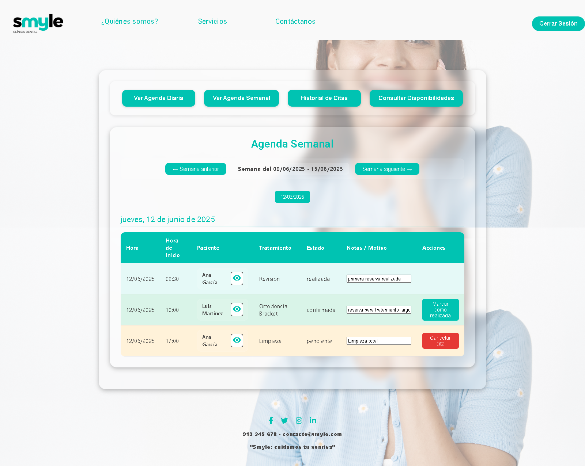

# SMYLE: CLÍNICA DENTAL — README
**Autor:** Fran Ramírez

**Curso** Full Stack Junior Developper con Java (Impulso_06)

---
# 📘 1. Introducción General
La aplicación **Dental Clinic** es una solución Full‑Stack completa desarrollada como proyecto académico y profesional. El objetivo es proporcionar un sistema sólido de **gestión integral de una clínica dental**, con módulos para:

- Gestión de pacientes
- Gestión de profesionales (dentistas)
- Agenda semanal y diaria
- Gestión de citas
- Disponibilidades automáticas por slot horario
- Seguridad con JWT
- Colección MongoDB complementaria
- Panel de administración completo

Este documento actúa como **README**, memoria técnica y guía de presentación del proyecto.  

---
# 📘 2. Arquitectura General del Proyecto
La solución está organizada en tres capas principales:

## 🟦 **Frontend — Angular 17**
- Aplicación SPA
- Gestión de sesiones con JWT
- Guardias de ruta según rol
- Agenda del dentista (diaria y semanal)
- Formularios reactivos
- Estilo moderno y consistente

## 🟧 **Backend — Spring Boot 3**
- API REST profesional
- Autenticación y autorización JWT
- Servicios especializados por módulo
- DTOs para proteger el modelo interno
- Manejo estricto de excepciones

## 🟩 **Bases de Datos**
### MySQL
Base de datos principal (relacional) para:
- Pacientes
- Usuarios (login)
- Profesionales
- Slots
- Disponibilidades
- Citas
- Tratamientos

### MongoDB
Colección auxiliar para almacenar información no crítica.  
En nuestro caso: **fecha de nacimiento de usuarios**.

---
# 📘 3. Instalación del Proyecto

## 3.1. Requisitos
- Java 17
- Node.js 18+
- Angular CLI 17+
- MySQL 8+
- MongoDB 6+
- Maven

## 3.2. Instalación del Backend
```bash
mvn clean install
mvn spring-boot:run
```
Backend disponible en:
```
http://localhost:8080
```

## 3.3. Instalación del Frontend
```bash
cd frontend
npm install
ng serve --open
```
Frontend disponible en:
```
http://localhost:4200
```

---
# 📘 4. Configuración del Sistema
## 4.1. Configuración MySQL
```properties
spring.datasource.url=jdbc:mysql://localhost:3306/clinica_dental
spring.datasource.username=root
spring.datasource.password=tu_password
spring.jpa.hibernate.ddl-auto=update
```

## 4.2. Configuración MongoDB
```properties
spring.data.mongodb.uri=mongodb://localhost:27017/clinica_dental_mongo
```

## 4.3. Configuración JWT
```properties
jwt.secret=MI_SECRETO_SUPERSEGURO
jwt.expiration=3600000
```

---
# 📘 5. Modelo de Datos (MySQL)
La estructura de BD se diseña para soportar una agenda profesional real.

Incluye la siguiente imagen del DER (presente en el repositorio backend):

📸 **Diagrama ER**  
*Ruta:* `src/docs/DER clinica_dental.png`



---
# 📘 6. Backend — Arquitectura Interna
El proyecto sigue un patrón clásico **Controller → Service → Repository**.

### 6.1. Controladores principales
- `AuthController`
- `UserController`
- `ProfessionalController`
- `PatientController`
- `AppointmentController`
- `AvailabilityController`
- `SlotController`
- `BirthDateController` (MongoDB)

### 6.2. Servicios
Cada servicio aplica reglas de negocio estrictas:
- Validación de unicidad
- Validación de estados
- Asociación correcta de relaciones
- Sincronización citas ↔ disponibilidades

### 6.3. Seguridad
El backend implementa:
- Filtro JWT
- UserDetailsService personalizado
- Roles con `ROLE_ADMIN`, `ROLE_DENTISTA`, `ROLE_PACIENTE`
- Rutas públicas y privadas

---
# 📘 7. Backend — Módulo de Disponibilidades
Este es uno de los módulos más avanzados.

### Reglas:
✔ Una disponibilidad es única por:  
💠 profesional + fecha + slot  
✔ No se puede borrar si tiene citas  
✔ No se puede cambiar el slot  
✔ No se puede cambiar el profesional  
✔ Puede cambiar el estado  
✔ Puede cambiar la fecha si **no tiene citas**

### Ejemplo DTO enriquecido
```json
{
  "id": 15,
  "professionalId": 3,
  "date": "2025-02-10",
  "status": "LIBRE",
  "slotId": 7,
  "startTime": "09:00",
  "endTime": "09:30",
  "period": "MAÑANA"
}
```

---
# 📘 8. Backend — Módulo de Citas
### Flujo al crear cita:
1) Se recupera disponibilidad  
2) Se verifica que esté **LIBRE**  
3) Se calcula la fecha de la cita:  
```java
LocalDateTime.of(av.getDate(), slot.getStartTime());
```
4) Se crea la cita  
5) Se marca la disponibilidad como **OCUPADO**

### Estados:
- Pendiente
- Confirmada
- Realizada
- Cancelada

---
# 📘 9. Backend — Módulo MongoDB
Se incluye por requisito académico.  
Colección: `user_birthdates`.

Ejemplo documento:
```json
{
  "_id": "650af31...",
  "userId": 4,
  "birthDate": "1995-10-11",
  "note": "dato académico"
}
```

---
# 📘 10. API REST — Endpoints más importantes

### 📍 Auth
- `POST /auth/login`
- `GET /auth/me`
- `POST /auth/register-patient`

### 📍 Users
- `GET /users`
- `PATCH /users/{id}/role`
- `PATCH /users/{id}/password`

### 📍 Professionals
- CRUD completo + relación 1:1 con User

### 📍 Availabilities
- Listado por profesional y fecha
- Creación
- Actualización (fecha/estado)
- Eliminación (soft)

### 📍 Appointments
- Crear cita
- Listar por paciente
- Listar por profesional
- Cambiar estado
- Cancelar cita

---
# 📘 11. Swagger — Documentación Automática
Swagger disponible en:  
```
http://localhost:8080/swagger-ui/index.html
```

## 📸 Captura de Swagger  


---
# 📘 12. Frontend — Angular 17
## 12.1. Estructura del proyecto
```
src/app
  ├── auth
  ├── core
  ├── pages
  │     ├── dashboard
  │     ├── dentista
  │     ├── agenda-diaria
  │     ├── agenda-semanal
  │     ├── pacientes
  │     ├── profesionales
  │     ├── citas
  ├── shared
```

## 12.2. Servicios principales
- AuthService
- AppointmentService
- AvailabilityService
- PatientService
- ProfessionalService

## 12.3. Capturas reales incluidas

### 📸 Pantalla de Login


### 📸 Gestión disponibilidades dentista


### 📸 Lista de Citas


### 📸 Agenda Semanal


---
# 📘 13. Flujo completo del sistema
1️⃣ Secretaria inicia sesión  
2️⃣ Consulta agenda del día  
3️⃣ Crea o mueve citas  
4️⃣ Dentista accede con su cuenta  
5️⃣ Consulta agenda semanal  
6️⃣ Marca citas como realizadas  
7️⃣ Admin gestiona profesionales y usuarios

---

# 📘 14. Mejoras Futuras
- Notificaciones por email
- Recordatorios automáticos
- Pasarela de pago
- Integración con apps móviles
- Panel BI con métricas

---
# 📘 15. Contacto
Proyecto desarrollado por **Fran Ramírez**

GitHub: https://github.com/fran-eliot  
LinkedIn: https://linkedin.com/in/franeliot

